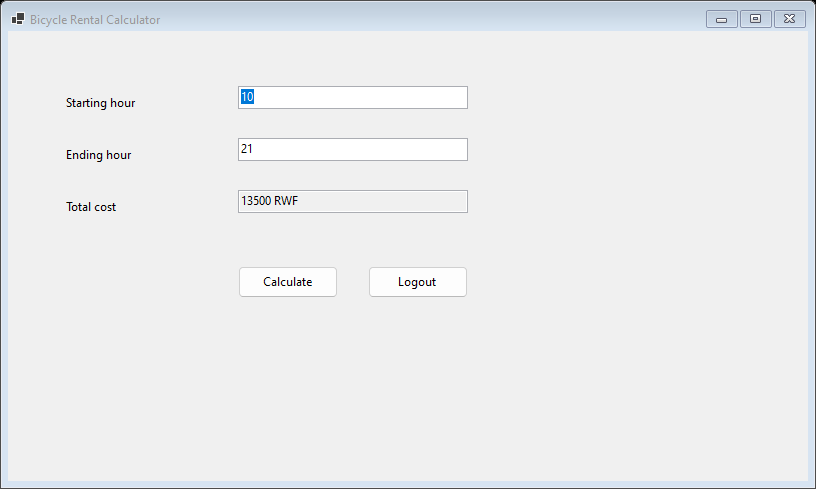

# Lab 2 Assignment

This repository contains two Windows Forms projects written in C#:

- **Bicycle Rental Calculator** (`Lab2`) calculates a rental price from the start and end hours.
- **Mushroom Identifier** (`mushroom`) asks yes/no questions and suggests a mushroom from the list in the app.

Each project runs on its own and has a simple login screen. The login forms only require both fields to be filled in; they do not check a username or password against an account.

## Bicycle Rental Calculator

Enter a start hour from 0 to 23 and an end hour from 1 to 24. The end hour must be later than the start hour. The calculator adds the rate for each rented hour:

| Hours | Rate per hour |
|---|---:|
| 00:00–06:59 and 21:00–23:59 | 500 RWF |
| 07:00–13:59 and 19:00–20:59 | 1,000 RWF |
| 14:00–18:59 | 1,500 RWF |

The example below rents a bicycle from hour 10 to hour 21 and totals 13,500 RWF.



## Mushroom Identifier

Choose a mushroom in mind from the list, then click **Start** and answer each yes/no question. The app follows those answers to show one of six names: Agaric Jaunissant, Amanite tue-mouche, Cèpe de Bordeaux, Coprin chevelu, Girolle, or Pied bleu.


## Login screens


## Run the projects

You need Windows and the .NET 10 SDK with the Windows Desktop workload.

Run either app from the repository root:

```powershell
dotnet run --project .\Lab2\Lab2.csproj
```

```powershell
dotnet run --project .\mushroom\mushroom.csproj
```

You can also open `Lab2.slnx` in Visual Studio and choose the project you want to start.

## Project structure

```text
Lab2.slnx
Lab2/        Bicycle rental calculator
mushroom/    Mushroom identifier
screenshots/ App screen images used in this README
```
