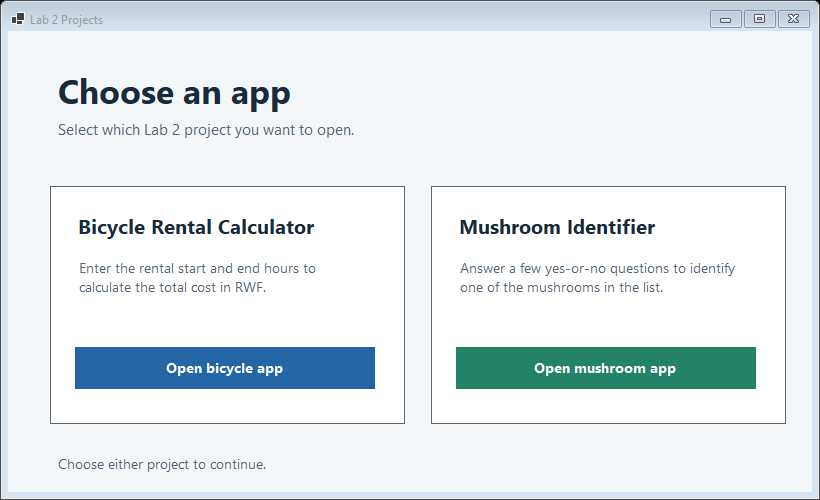
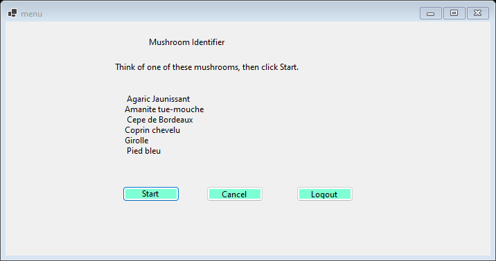
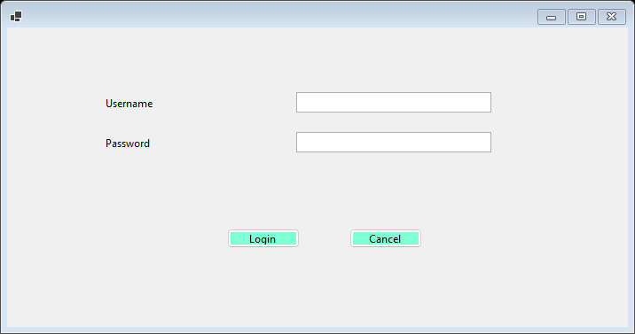
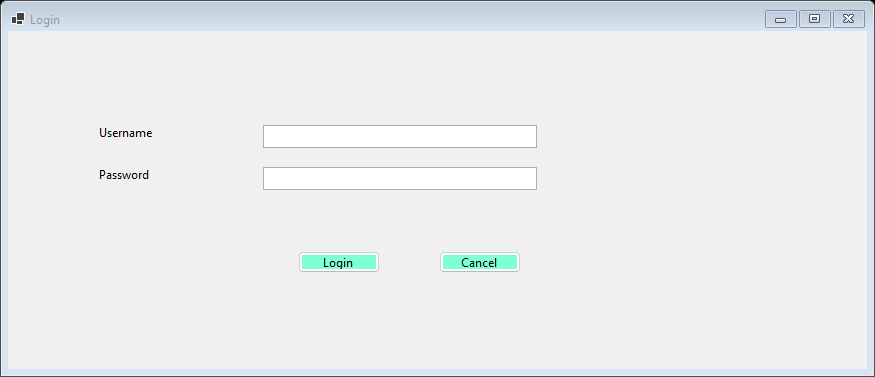

# Lab 2 Assignment

This repository brings two Windows Forms projects together behind one app chooser. Start the launcher and choose **Bicycle Rental Calculator** or **Mushroom Identifier**. When you close the selected app, the chooser appears again.



## Bicycle Rental Calculator

Enter a start hour from 0 to 23 and an end hour from 1 to 24. The end hour must be later than the start hour. The calculator adds the rate for each rented hour:

| Hours | Rate per hour |
|---|---:|
| 00:00–06:59 and 21:00–23:59 | 500 RWF |
| 07:00–13:59 and 19:00–20:59 | 1,000 RWF |
| 14:00–18:59 | 1,500 RWF |

This example rents a bicycle from hour 10 to hour 21 and totals 13,500 RWF.


## Mushroom Identifier

Choose a mushroom from the list, click **Start**, then answer the yes-or-no questions. The app suggests one of six names: Agaric Jaunissant, Amanite tue-mouche, Cèpe de Bordeaux, Coprin chevelu, Girolle, or Pied bleu.



## Login screens

Both apps show a login form. The forms require a username and password to be entered, but they do not check those values against an account.





## Run the assignment

You need Windows and the .NET 10 SDK with the Windows Desktop workload. From the repository root, run:

```powershell
dotnet run --project .\Launcher\Launcher.csproj
```

The launcher builds the two projects and opens the app chooser. In Visual Studio, open `Lab2.slnx` and set **Launcher** as the startup project.

## Project structure

```text
Lab2.slnx
Launcher/    App chooser
Lab2/        Bicycle rental calculator
mushroom/    Mushroom identifier
screenshots/ App images used in this README
```
